# FoodTrip - Full-Stack Food Delivery & Restaurant Platform | Spring Boot & React

<p align="center">
  
</p>

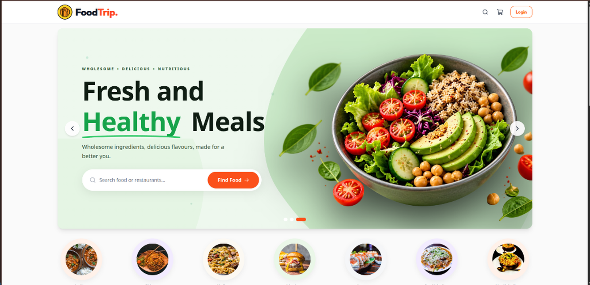

<p align="center">
  A full-stack multi-role food ordering and restaurant management platform built with Spring Boot, Java 17, React, Tailwind CSS, MySQL, and AWS (EC2, RDS, S3, CloudFront), featuring role-based access control, restaurant discovery, category-based menus, persistent shopping cart synchronization, real-time order tracking, and restaurant business verification.
</p>

<p align="center">
  
  
  
  
  
  
  
  
  
</p>

---

## Overview

**FoodTrip** is a decoupled full-stack food delivery and restaurant management platform connecting customers, restaurant partners, and administrators. Built with a Spring Boot REST API backend and a React single-page application frontend, it provides dedicated workflows for three primary user roles:

- **Customer**: Discover local dining establishments, explore categorized menus with dietary filters, manage shopping carts with offline-to-server synchronization, place orders, and track order fulfillment in real time.
- **Restaurant Partner**: Complete business compliance verification, manage dishes with live stock toggles and direct AWS S3 image uploads, fulfill incoming orders through kitchen queue controls, and configure restaurant profile details.
- **Admin**: Audit and verify restaurant onboarding requests with mandatory rejection logging, monitor platform-wide transaction analytics, and manage active restaurant listings.

---

## Key Features

### Customer Experience
- **Popular & Geolocation Recommendations**: Dynamic carousels highlighting trending dining spots and nearest restaurants detected via user IP geolocation.
- **Restaurant Discovery & Filtering**: Search restaurants by name and filter by cuisine type (Indian, Chinese, Italian, Mexican, etc.), ratings, and delivery estimates.
- **Categorized Menu Storefront**: Explore restaurant menus with vegetarian/non-vegetarian dietary badges and categorized tabs (Starters, Main Course, Desserts, Beverages).
- **Dual-Tier Cart Synchronization**: Instant client-side cart updates with automatic backend synchronization (`/api/cart/sync`) upon authentication.
- **Checkout & Saved Addresses**: Delivery address selection, dynamic fee calculations, and one-click order placement.
- **Live Order Tracking**: Visual progression tracker monitoring order states (`PENDING` ➔ `CONFIRMED` ➔ `PREPARING` ➔ `OUT_FOR_DELIVERY` ➔ `DELIVERED`).
- **Order History**: Transaction ledger with itemized digital receipts and delivery timestamps.

### Restaurant Partner Portal
- **Partner Dashboard**: Operational metrics displaying Total Orders, Gross Revenue, Pending Orders count, and Customer Ratings.
- **Business Verification Workflow**: Self-service onboarding capturing FSSAI license numbers, business documentation, and address verification.
- **Menu Management**: Create, edit, and delete food items with pricing, dietary categorization, and AWS S3 media uploads.
- **Instant Availability Toggles**: One-click switches (`isAvailable`) to mark dishes in-stock or sold-out in real time.
- **Kitchen Order Queue**: Tabbed live order management board with stage transitions (`Preparing`, `Out for Delivery`, `Delivered`).
- **Store Configuration**: Manage store operating hours, contact details, minimum order values, and banner imagery.

### Administrative Command Center
- **Executive Analytics**: Real-time KPI summary tracking Total Users, Total Restaurants, Total Food Items, and Global Order Volume.
- **Verification Audit Queue**: Review partner onboarding dossiers with one-click approvals and mandatory rejection justification audits.
- **Listing Governance**: Enable, disable, or moderate restaurant storefronts and food items across the platform.

### Cloud & Media Pipeline
- **AWS S3 Object Storage**: Multipart image uploads for restaurant banners and food item photos.
- **CloudFront Global CDN**: High-speed edge asset streaming through CloudFront distribution `d1do212giwnd6s.cloudfront.net`.

---

## Platform Walkthrough

### 1. Landing Page & Cuisine Discovery
The primary customer discovery portal showcasing promotional hero banners, interactive search, and responsive cuisine category carousels (Indian, Chinese, Italian, Street Food, Desserts). Allows diners to instantly browse food categories and initiate dish exploration with single-click filtering.

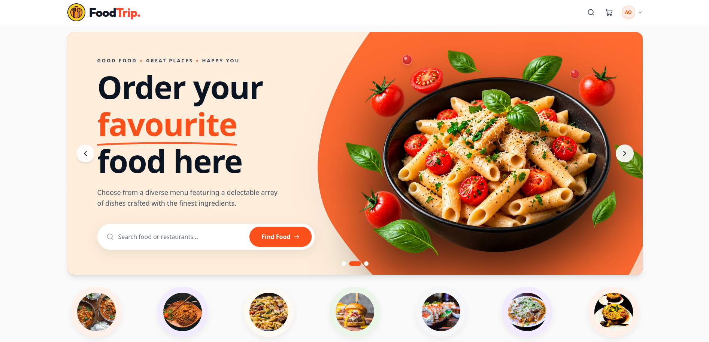

---

### 2. Popular & Location-Based Recommendations
Curated discovery feeds presenting trending restaurants and nearby dining establishments powered by client IP geolocation. Features real-time operational status badges (`Open`/`Closed`), customer review scores, estimated preparation and delivery times, and direct storefront navigation.

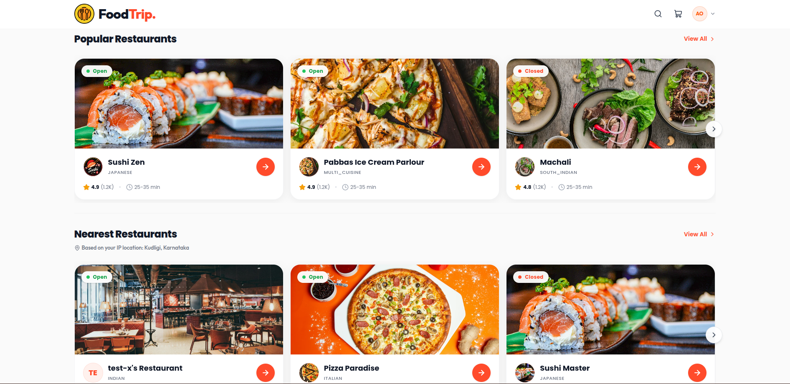

---

### 3. Restaurant Discovery & Catalog Filtering
Comprehensive restaurant directory providing dynamic search and multi-parameter catalog filtering. Users can narrow down establishments by cuisine type, minimum rating, pricing tier, and delivery estimates, with responsive cards displaying kitchen specializations and current operating states.

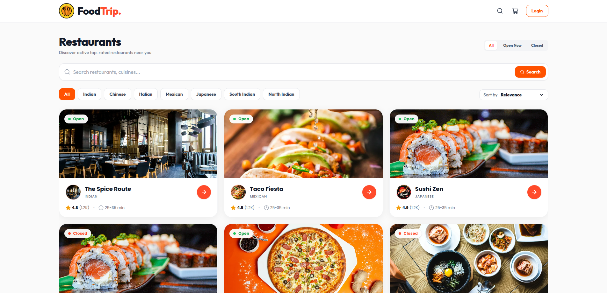

---

### 4. Restaurant Storefront & Menu Catalog
Dedicated restaurant storefront featuring cover banners, operating hours, delivery estimates, and category-partitioned menus (Starters, Main Course, Desserts, Beverages). Displays vegetarian/non-vegetarian dietary classification badges, dish descriptions, item pricing, and instant "Add to Cart" controls.

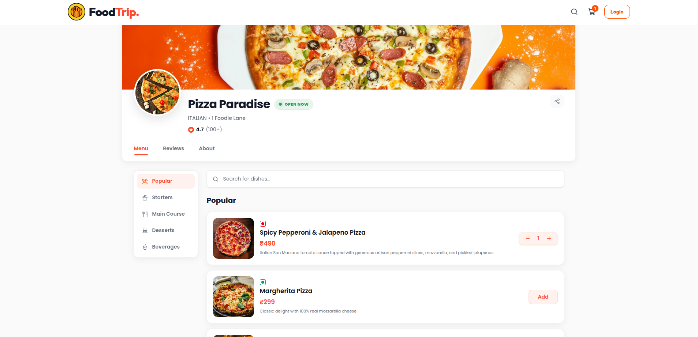

---

### 5. Interactive Cart Drawer
Global slide-over cart drawer accessible across all views with live quantity adjusters, fee breakdowns, and real-time subtotal calculations. Automatically synchronizes local guest items with the backend server upon signing in, ensuring seamless multi-device persistence.

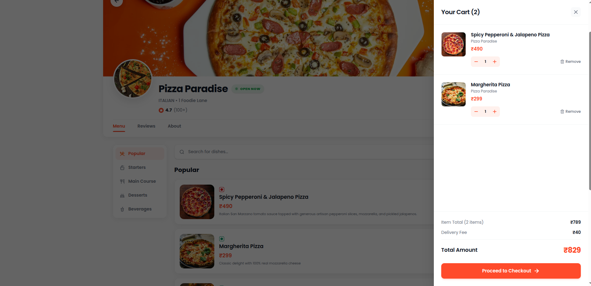

---

### 6. User Authentication - Sign In
Secure credential validation modal supporting email and password authentication. Generates and stores stateless JWT Bearer tokens in secure client cookies, dynamically hydrating user roles (`ROLE_CUSTOMER`, `ROLE_RESTAURANT`) and establishing authenticated application state.

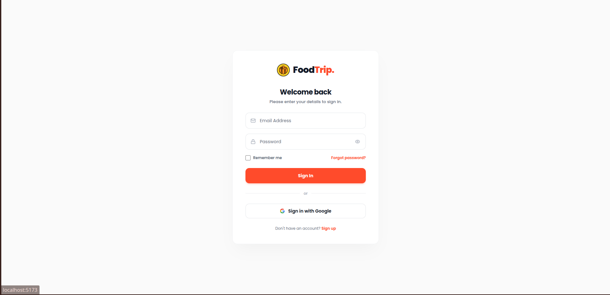

---

### 7. User Authentication - Registration
Onboarding dialog for new customers and restaurant owners with real-time field validation. Captures user identity, contact details, role selection, and encrypted passwords (BCrypt hashed on the backend), providing immediate session creation upon successful sign-up.

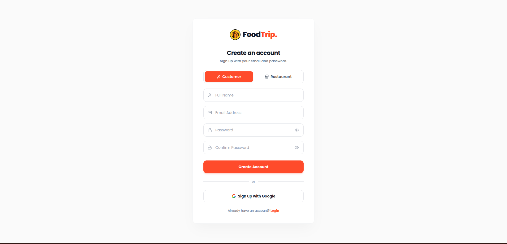

---

### 8. Checkout & Delivery Address Selection
Structured checkout interface allowing customers to choose from saved addresses or register a new delivery point. Features an itemized order summary, delivery fee calculations, and one-click order placement with server-side inventory validation.

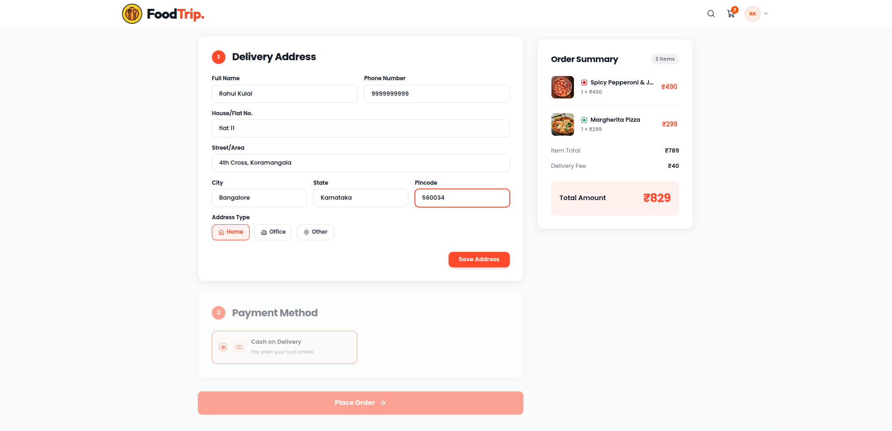

---

### 9. Live Multi-Stage Order Tracking
Interactive modal tracking real-time order progression from kitchen confirmation to doorstep delivery: `PENDING` ➔ `CONFIRMED` ➔ `PREPARING` ➔ `OUT_FOR_DELIVERY` ➔ `DELIVERED`. Features active status indicators, delivery address details, and cancellation support for pending orders.

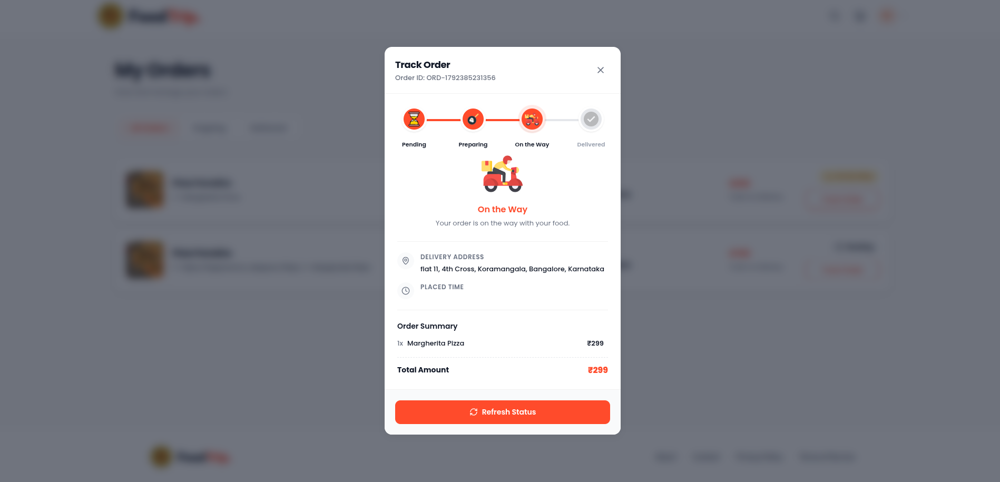

---

### 10. Customer Order History Ledger
Persistent transaction ledger listing past customer orders with unique order identifiers, placement timestamps, itemized dish breakdowns, total paid amounts, and final fulfillment statuses, enabling diners to review past meals and track active deliveries.

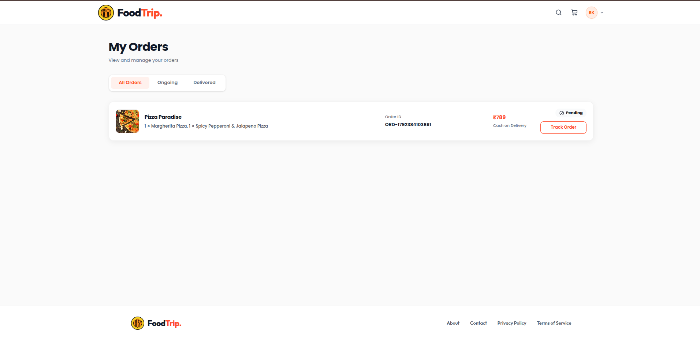

---

### 11. Restaurant Partner Dashboard
Operational command center for restaurant partners featuring real-time KPI metrics: Total Order Volume, Gross Platform Revenue, Pending Orders count requiring kitchen attention, and Average Customer Rating scores. Serves as the primary operational hub for day-to-day fulfillment.

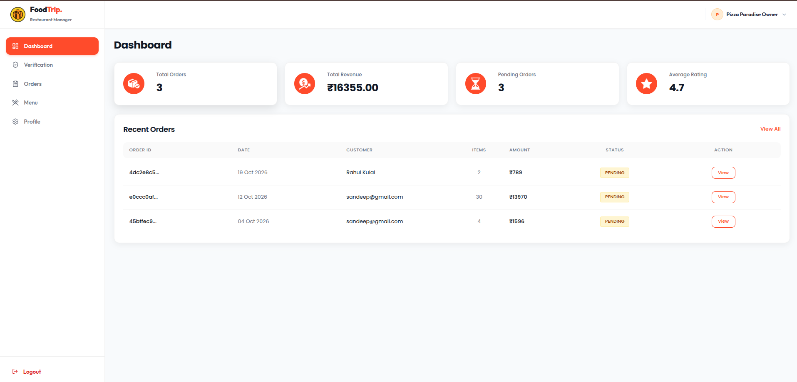

---

### 12. Restaurant Verification Onboarding
Self-service compliance portal where new restaurant partners submit mandatory business documentation, including trade licenses, FSSAI registration numbers, kitchen operational details, and contact information for administrative vetting and platform approval.

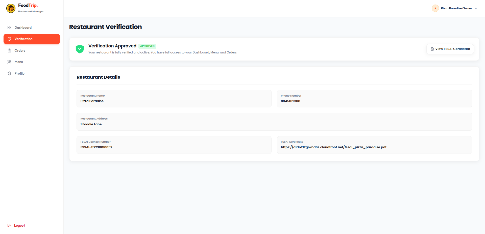

---

### 13. Kitchen Live Order Queue
Real-time kitchen order management board categorizing incoming orders into lifecycle tabs (`Pending`, `Preparing`, `Out for Delivery`, `Delivered`). Displays customer contact details, itemized kitchen tickets, delivery addresses, and actionable status update buttons.

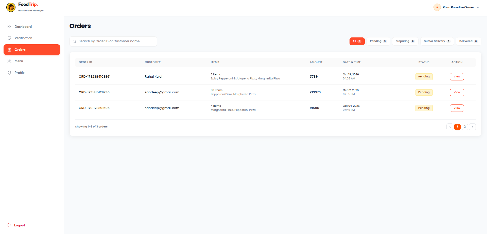

---

### 14. Order Status Transition Modal
Interactive workflow modal enabling kitchen staff to advance active orders through fulfillment milestones (`Preparing` ➔ `Out for Delivery` ➔ `Delivered`). Immediately updates the customer tracking view and maintains an audit trail across order lifecycle transitions.

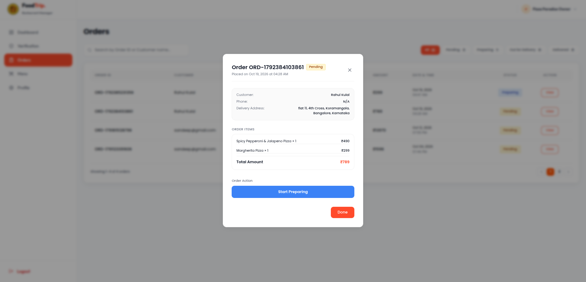

---

### 15. Menu Items Catalog
Restaurant catalog management table listing all dishes offered by the establishment. Displays dish thumbnails, pricing, category classifications, and instant one-click toggle switches (`isAvailable`) to take out-of-stock items offline in real time.

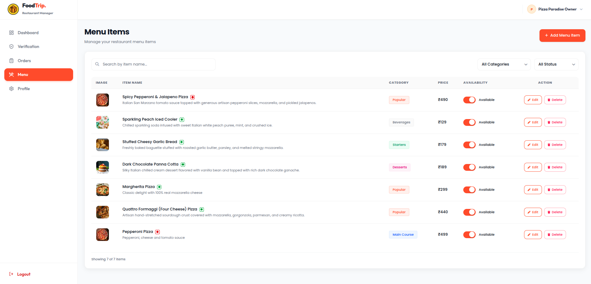

---

### 16. Add New Dish Modal
Menu item creation form supporting dish naming, category assignment, pricing, descriptions, vegetarian/non-vegetarian dietary flags, and direct multi-part image uploads to Amazon S3 with CloudFront CDN edge delivery.

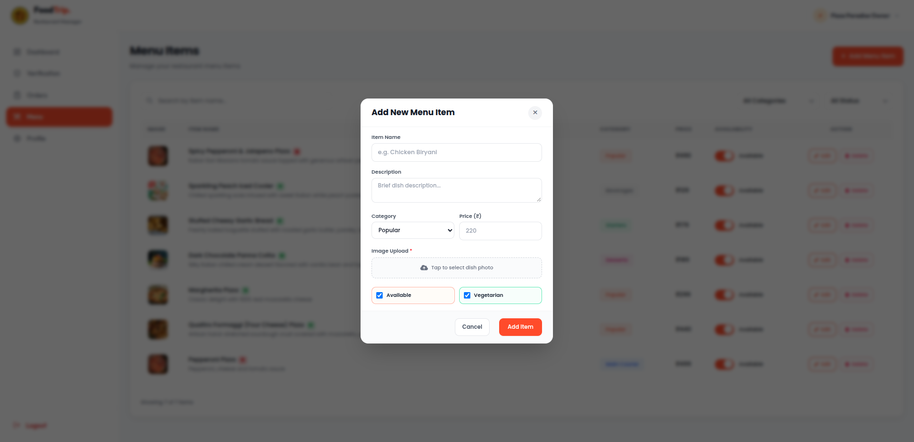

---

### 17. Restaurant Profile & Store Settings
Configuration interface for partners to update operating hours, delivery radius estimates, minimum order thresholds, contact phone numbers, and promotional restaurant banner imagery.

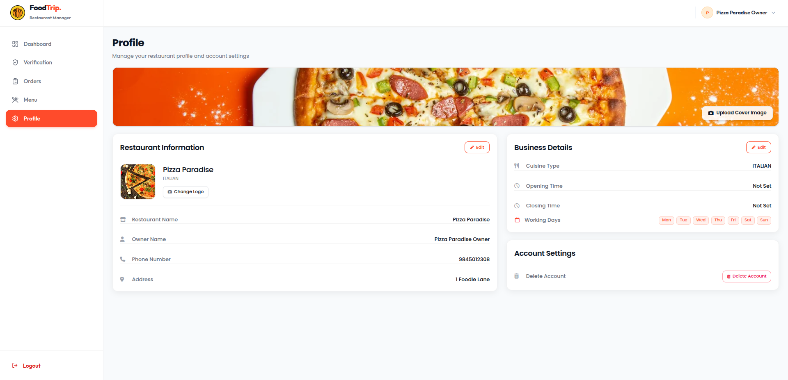

---

### 18. Admin Analytics Dashboard
Platform command center displaying system-wide operational metrics: Total Registered Users, Active Restaurant Partners, Total Menu Items in Catalog, and Global Order Volume across the entire platform.

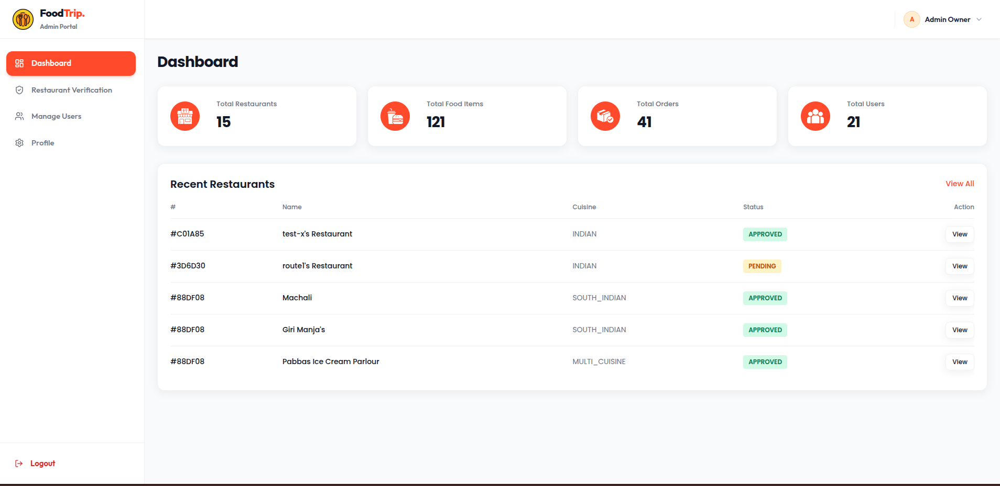

---

### 19. Restaurant Verification Review Queue
Compliance audit desk where platform administrators review submitted restaurant onboarding dossiers, verify business licenses and FSSAI credentials, and render one-click approval decisions to grant official operating badges.

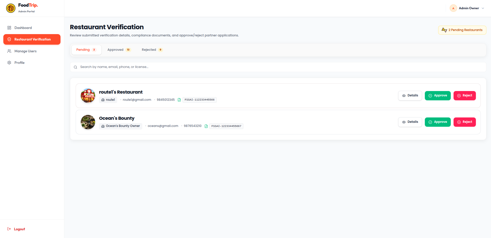

---

### 20. Verification Rejection Reason Audit Dialog
Mandatory justification dialog enforcing regulatory transparency by requiring administrators to document formal audit reasons when rejecting unapproved partner applications, ensuring clear compliance feedback.

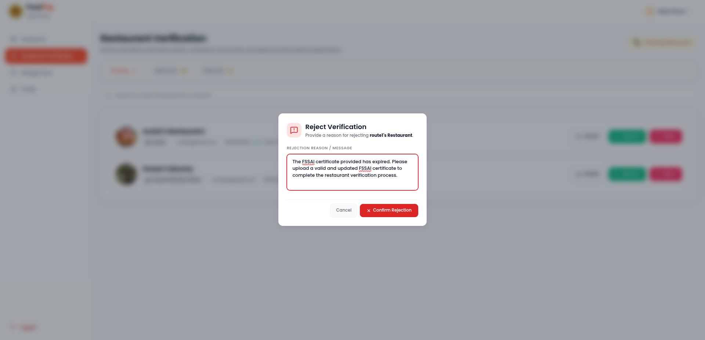

---

## Technical Architecture

### Backend Stack
| Layer | Technology | Specification |
| :--- | :--- | :--- |
| **Runtime** | Java | Version 17 (LTS) |
| **Framework** | Spring Boot | Version 3.4.1 |
| **Persistence** | Spring Data JPA / Hibernate 6 | Object-Relational Mapping (`MySQLDialect`) |
| **Security** | Spring Security + JJWT 0.12.6 | Stateless JWT Authentication & Role-Based Access Control |
| **Database** | MySQL / AWS RDS | Amazon Relational Database Service (MySQL 8.0 Engine) |
| **Cloud Storage** | AWS SDK for Java v2 (S3) | Object Storage (`software.amazon.awssdk:s3:2.27.12`) |
| **CDN Delivery** | AWS CloudFront | Global Edge Caching (`d1do212giwnd6s.cloudfront.net`) |
| **Build Tool** | Apache Maven | Maven Wrapper (`./mvnw`) |

### Frontend Stack
| Layer | Technology | Specification |
| :--- | :--- | :--- |
| **Framework** | React | Version 19.2.8 |
| **Build Tool** | Vite | Version 8.2.2 (Fast HMR & Bundling) |
| **Styling** | Tailwind CSS | Version 4.3.3 (`@tailwindcss/vite`) |
| **Routing** | React Router | Version 7.18.3 (`react-router-dom`) |
| **State Management** | React Context API | `AuthContext` (JWT) & `CartContext` (Cart State) |
| **Icons & Media** | Lucide React & Lottie React | Vector icons and JSON vector animations |
| **Code Quality** | Oxlint | High-speed static analysis linter |

---

## Project Structure

```text
foodtrip/
├── backend/                  # Spring Boot 3.4.1 REST API (Java 17, Maven)
│   ├── src/main/java/        # Controllers, business services, JPA entities, security filters
│   ├── src/main/resources/   # application.properties & database configuration
│   ├── src/test/java/        # JUnit 5 & Mockito test suites
│   ├── .env.example          # Backend environment variable template
│   └── pom.xml               # Maven dependencies and build manifest
│
├── frontend/                 # React 19 + Tailwind CSS v4 SPA (Vite)
│   ├── src/components/       # Reusable components (CartDrawer, Navbar, TrackOrderModal)
│   ├── src/pages/            # Customer, Restaurant partner, and Admin views
│   ├── src/context/          # Global AuthContext (JWT) and CartContext (Cart state)
│   ├── src/services/         # API fetch client with Bearer token injection
│   ├── .env.example          # Frontend environment variable template
│   └── package.json          # Frontend dependencies and npm scripts
│
├── docs/screenshots/         # Verified platform workflow screenshots
├── LICENSE                   # MIT License
└── README.md                 # Project documentation
```

---

## Getting Started

### Prerequisites
- **Java Development Kit (JDK)**: Version 17 or higher
- **Node.js**: Version 18.x or 20.x with npm
- **MySQL Server** (8.0+) OR an **AWS RDS MySQL** instance
- *(Optional)* **Amazon Web Services** account with an S3 bucket configured

---

### 1. Backend Configuration & Setup

1. Navigate to the backend directory:
   ```bash
   cd backend
   ```

2. Establish your environment file:
   ```bash
   # Unix/macOS:
   cp .env.example .env

   # Windows (PowerShell):
   Copy-Item .env.example .env
   ```

3. Configure connection details in `backend/.env`:
   ```env
   DB_URL=jdbc:mysql://localhost:3306/foodtrip
   DB_USERNAME=your_database_username
   DB_PASSWORD=your_database_password
   JWT_SECRET=your_secure_256_bit_jwt_secret_key
   AWS_ACCESS_KEY_ID=your_aws_access_key
   AWS_SECRET_ACCESS_KEY=your_aws_secret_key
   ```

4. Launch the Spring Boot service:
   ```bash
   # Unix/macOS:
   ./mvnw spring-boot:run

   # Windows:
   .\mvnw.cmd spring-boot:run
   ```
   The backend service binds to **`http://localhost:8080`**.

---

### 2. Frontend Configuration & Setup

1. Open a new terminal and navigate to the frontend directory:
   ```bash
   cd frontend
   ```

2. Install dependencies:
   ```bash
   npm install
   ```

3. Establish your environment file:
   ```bash
   # Unix/macOS:
   cp .env.example .env

   # Windows (PowerShell):
   Copy-Item .env.example .env
   ```

4. Verify the backend API URL in `frontend/.env`:
   ```env
   VITE_API_BASE_URL=http://localhost:8080
   ```

5. Launch the development server:
   ```bash
   npm run dev
   ```
   The application will be accessible at **`http://localhost:5173`**.

---

## License

This project is licensed under the **MIT License**. See the [LICENSE](LICENSE) file for details.
